# Práctica de Frameworks Web: React y Vue


## 1. Introducción

En esta práctica desarrollé una aplicación de usuarios utilizando dos frameworks diferentes: React y Vue. Mi objetivo fue realizar las mismas funciones en ambos proyectos para conocer cómo se trabaja con cada uno y comparar sus diferencias.

Para desarrollar las aplicaciones utilicé Visual Studio Code, JavaScript, Node.js y Vite. También trabajé con una API pública que me permitió obtener información de usuarios sin necesidad de crear una base de datos.


## 2. Descripción de la aplicación

Desarrollé un directorio de usuarios que muestra información obtenida de una API pública.

En las dos aplicaciones implementé las siguientes funciones:

- Consultar usuarios desde una API.
- Mostrar el nombre, correo electrónico y ciudad.
- Buscar usuarios por su nombre.
- Agregar usuarios a favoritos.
- Quitar usuarios de favoritos.
- Mostrar la cantidad de favoritos seleccionados.
- Visualizar solamente los usuarios favoritos.
- Mostrar un mensaje mientras se cargan los datos.
- Mostrar un mensaje si ocurre un error.

Para el diseño utilicé colores rosados y lilas, con tarjetas para mostrar la información de cada usuario. Mantuve una apariencia similar en los dos proyectos.

## 3. API utilizada

Para obtener los datos utilicé la API pública JSONPlaceholder:

https://jsonplaceholder.typicode.com/users

Realicé la consulta mediante `fetch()` utilizando el método GET.

Esta API me permitió trabajar con información de prueba sin tener que instalar un servidor adicional.

## 4. Desarrollo en React

Primero desarrollé la aplicación utilizando React.

En el archivo `App.jsx` organicé las funciones principales, como consultar los usuarios, realizar las búsquedas y manejar los favoritos.

También creé el componente `UsuarioCard.jsx` para mostrar los datos de cada usuario dentro de una tarjeta.

Para guardar la información utilicé `useState`, mientras que con `useEffect` realicé la consulta a la API cuando se inicia la aplicación.

Para el buscador utilicé una función que filtra los usuarios según el nombre ingresado.

### 4.1. Cómo ejecutar React

Desde la carpeta principal del proyecto ejecuto:

```bash
cd react-usuarios
npm install
npm run dev
```

Después abro en el navegador la dirección local que muestra Vite.

### 4.2. Evidencias de React

#### Aplicación principal

En esta captura muestro cómo se visualizan los usuarios con su nombre, correo electrónico y ciudad.

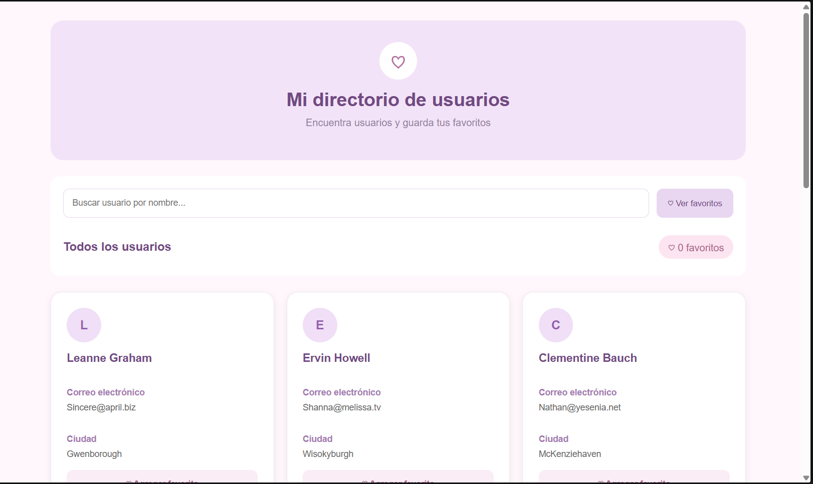

#### Búsqueda de usuarios

Aquí comprobé que puedo encontrar un usuario escribiendo su nombre en el buscador.

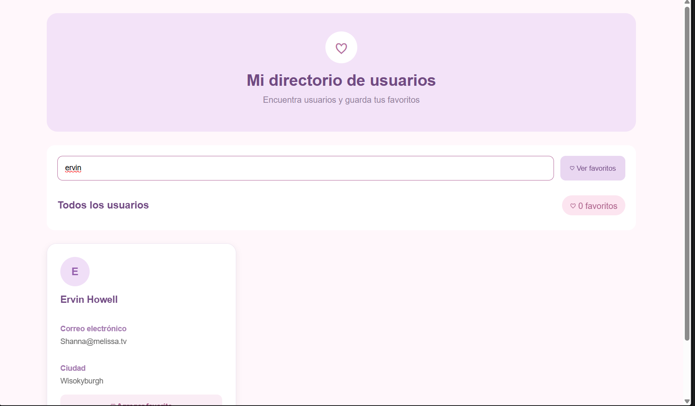

#### Agregar a favoritos

En esta parte seleccioné un usuario como favorito.

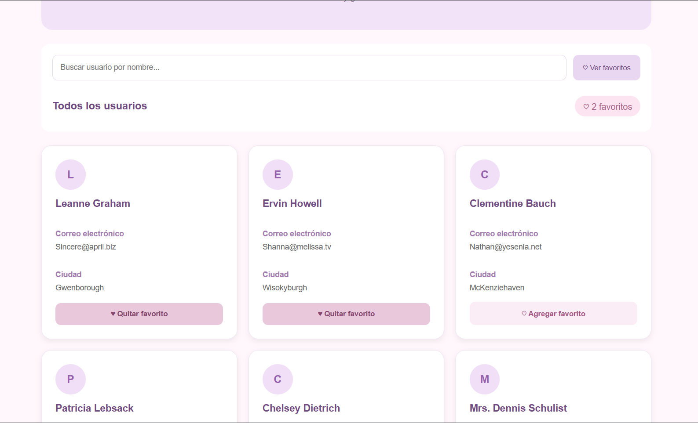

#### Ver favoritos

Aquí utilicé el filtro para mostrar solamente los usuarios que había seleccionado.

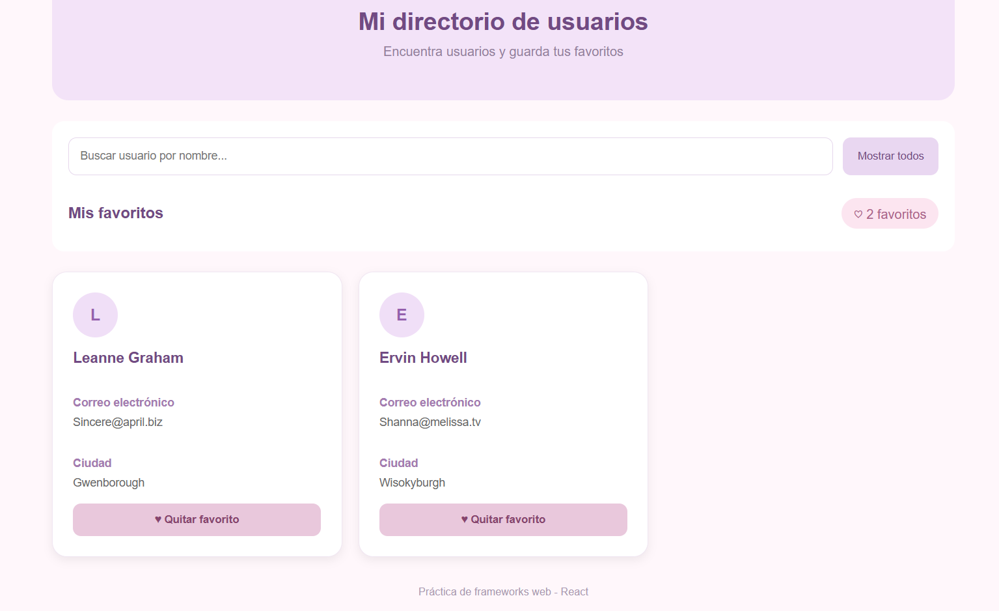

#### Quitar favoritos

También comprobé que puedo quitar usuarios de la lista de favoritos.

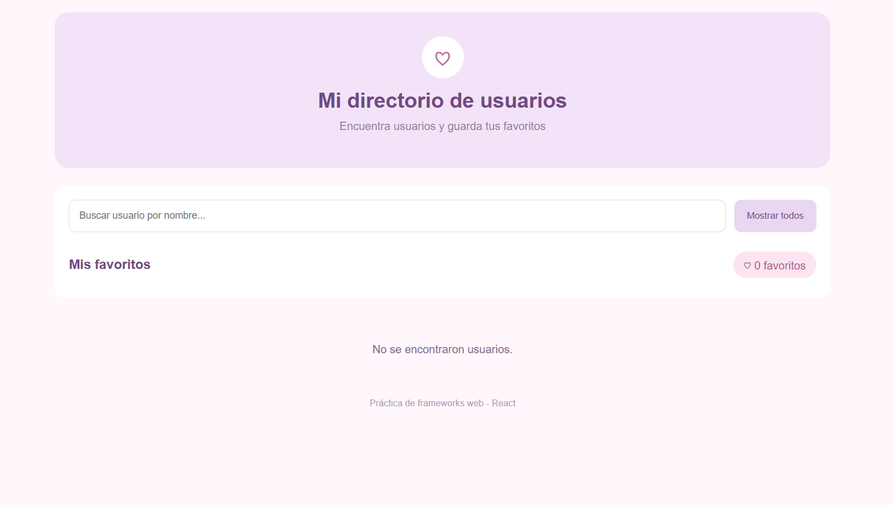

#### Prueba unitaria

Realicé una prueba para comprobar que la búsqueda por nombre funciona correctamente. El resultado fue de una prueba aprobada.

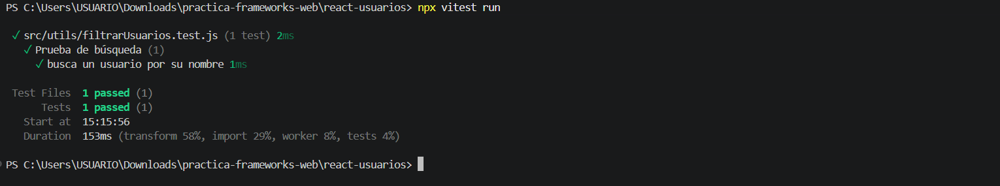

#### Compilación de React

Ejecuté `npm run build` y comprobé que el proyecto se compiló sin errores.

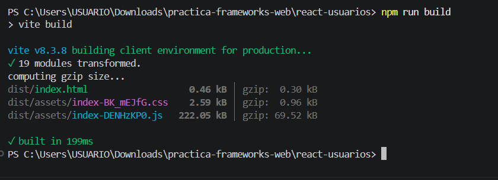

## 5. Desarrollo en Vue

Después desarrollé la misma aplicación utilizando Vue.

En el archivo `App.vue` trabajé con la consulta de usuarios, el buscador y el manejo de favoritos.

También creé el componente `UsuarioCard.vue` para mostrar los datos de cada usuario.

Para guardar la información utilicé `ref`, mientras que con `onMounted` realicé la consulta a la API cuando se inicia la aplicación.

Utilicé `computed` para actualizar los resultados de la búsqueda, `v-model` para relacionar el campo de búsqueda con los datos y `v-for` para mostrar las tarjetas.

Al desarrollar esta versión pude observar que Vue utiliza una forma diferente de organizar el código, aunque las funciones son las mismas.

### 5.1. Cómo ejecutar Vue

Desde la carpeta principal del proyecto ejecuto:

```bash
cd vue-usuarios
npm install
npm run dev
```

Después abro en el navegador la dirección local que muestra Vite.

### 5.2. Evidencias de Vue

#### Aplicación principal

En esta captura muestro el directorio de usuarios que desarrollé con Vue.

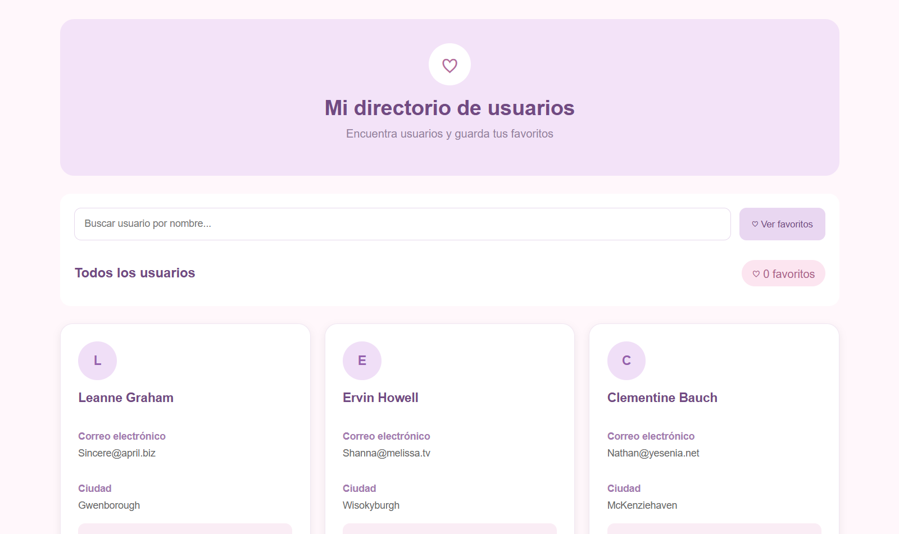

#### Búsqueda de usuarios

Aquí comprobé que puedo buscar usuarios escribiendo su nombre.

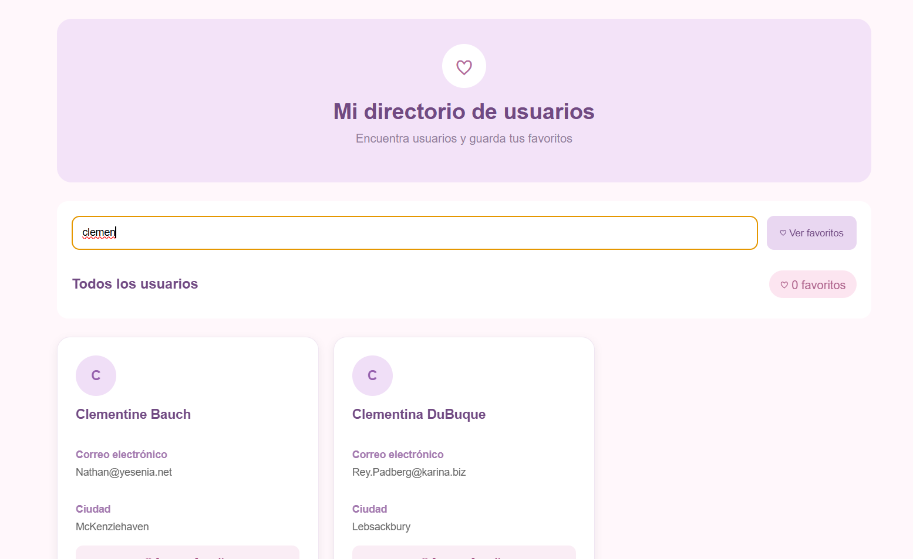

#### Agregar a favoritos

En esta parte seleccioné un usuario como favorito.

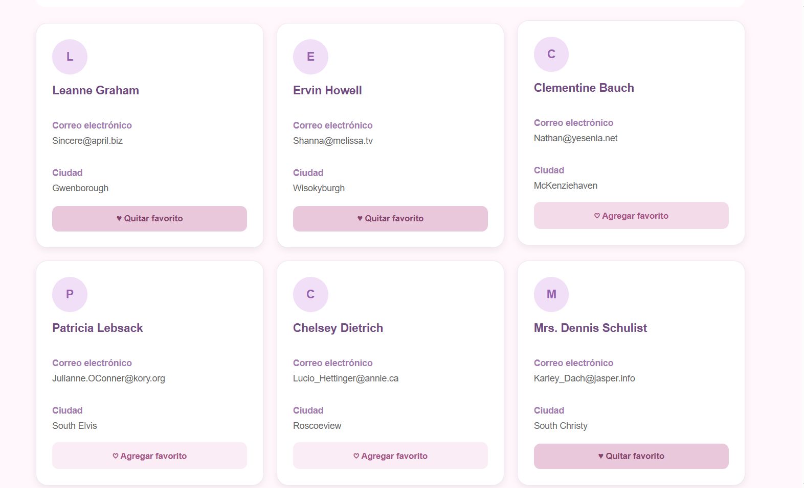

#### Ver favoritos

Aquí utilicé el filtro para mostrar solamente los usuarios que había seleccionado.

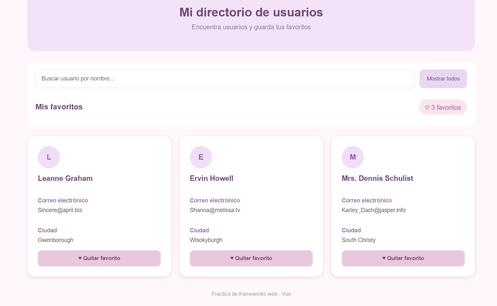

#### Quitar favoritos

También comprobé que puedo quitar usuarios de favoritos.

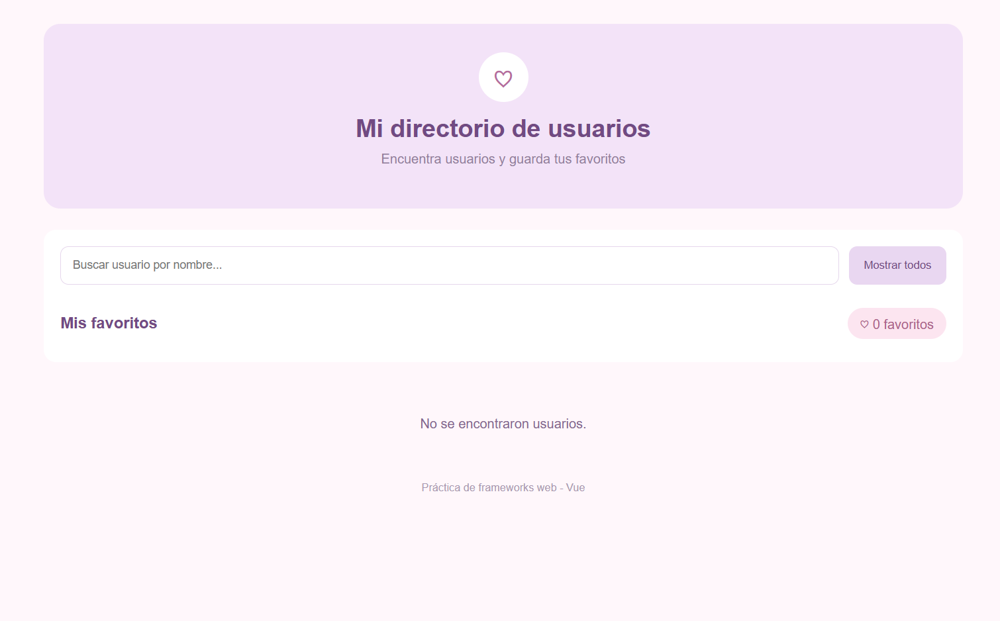

#### Prueba unitaria

Realicé una prueba para verificar que la búsqueda por nombre funciona correctamente. El resultado fue de una prueba aprobada.

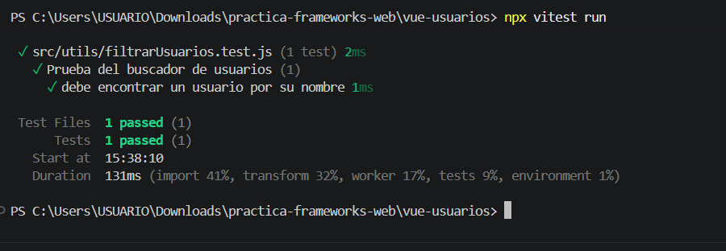

#### Compilación de Vue

Ejecuté `npm run build` y comprobé que la aplicación se compiló sin errores.

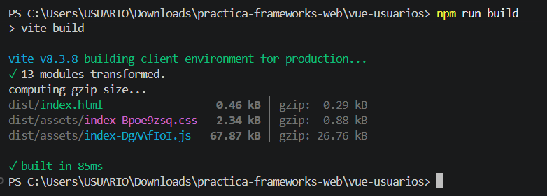

## 6. Pruebas realizadas

Para comprobar el funcionamiento de mis aplicaciones utilicé Vitest.

En React realicé una prueba para verificar que la función de búsqueda encontrara un usuario por su nombre. La prueba pasó correctamente.

Después realicé una prueba similar en Vue y también obtuve un resultado correcto.

Para ejecutar las pruebas utilicé el siguiente comando dentro de cada proyecto:

```bash
npx vitest run
```

También comprobé que los dos proyectos se compilaran correctamente mediante:

```bash
npm run build
```

En ambos proyectos obtuve una compilación sin errores.


## 7. Conclusiones

Al realizar esta práctica pude conocer mejor cómo se trabaja con React y Vue. Aunque desarrollé la misma aplicación, encontré diferencias en la manera de organizar los archivos, manejar los datos y mostrar la información.

En React practiqué el uso de `useState` y `useEffect`, mientras que en Vue trabajé con `ref`, `computed` y `onMounted`.

También aprendí a consultar información desde una API, mostrar los resultados en tarjetas, realizar búsquedas y manejar una lista de favoritos.

Finalmente, las pruebas unitarias me permitieron comprobar que la función de búsqueda funciona correctamente en ambos proyectos. Además, pude verificar que las dos aplicaciones se compilan sin errores.
